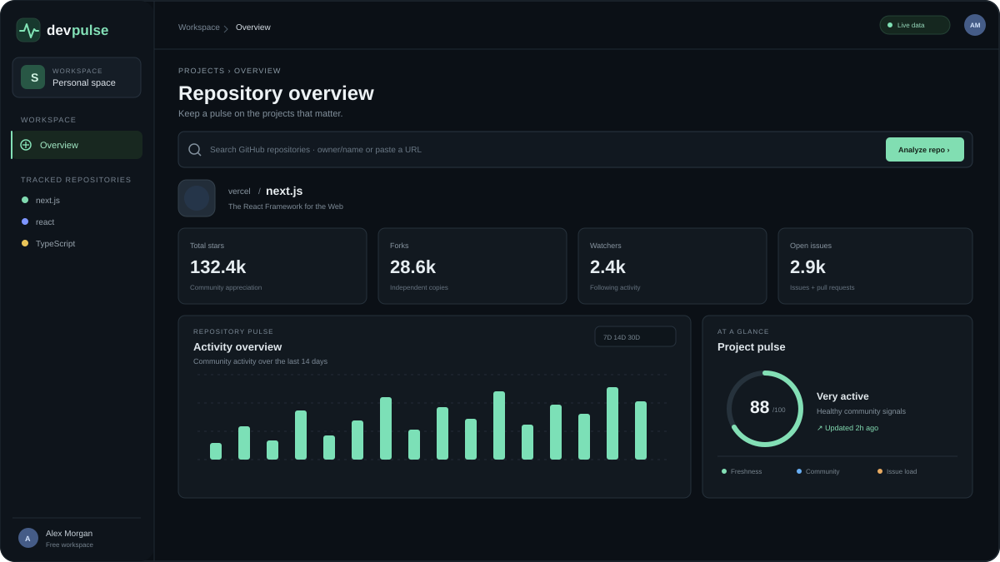

# DevPulse

**Open source, in focus.** DevPulse is a small repository intelligence dashboard built with React and TypeScript. Search any public GitHub repository to inspect its community signals, recent activity, language mix, and contributor activity in one place.



## Features

- Search by `owner/repository` or paste a GitHub repository URL.
- View stars, forks, watchers, open issues, recent activity, and top contributors.
- Explore language composition and event activity over 7, 14, or 30 days.
- Compare two public repositories side by side.
- Start with a sample dashboard and switch to live GitHub data when the API responds.
- Responsive dark interface with keyboard focus styles and clear loading and error states.

## Tech stack

- React 19 and TypeScript
- Vite
- Recharts for the activity chart
- Lucide for icons
- GitHub REST API (public, unauthenticated endpoints)

## Getting started

Requirements: Node.js 22.18+ (Node.js 24 LTS recommended) and npm.

```bash
git clone https://github.com/cagatay2892/devpulse.git
cd devpulse
npm install
npm run dev
```

Open the local URL printed by Vite. To create a production build:

```bash
npm run build
npm run preview
```

## How the data works

The dashboard calls GitHub's public REST API directly from the browser. It does not ask for or store a GitHub token. Unauthenticated API requests are rate limited by GitHub; if the limit is reached, DevPulse keeps the current dashboard visible and explains when to retry. The opening `vercel/next.js` view is clearly marked as sample data until a live response succeeds.

The Project Pulse score is a transparent heuristic based on recent push recency, community size, and the open issue to star ratio. It is an orientation signal for comparing repositories, not a quality or security rating.

## Project structure

```text
src/
  lib/
    demo.ts       Sample repository data for the opening preview
    github.ts     GitHub API client and response types
  App.tsx         Dashboard, search, compare view, and UI components
  App.css         Layout, components, and responsive styles
  index.css       Global styles and theme defaults
```

## Contributing

Issues and pull requests are welcome. For a focused change, open an issue first so the scope is clear. Keep the API client token-free, preserve the public API rate-limit messaging, and include screenshots for visible UI changes.

## License

MIT. See [LICENSE](LICENSE).
